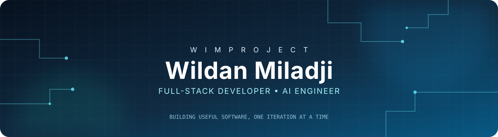
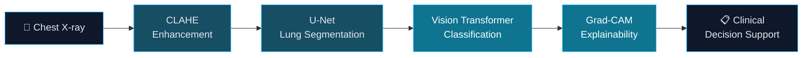

<div align="center">




<br>

<a href="https://github.com/WiMProject">
  
</a>
<a href="https://github.com/WiMProject?tab=followers">
  
</a>
<a href="https://github.com/WiMProject?tab=repositories">
  
</a>

<br>

<a href="https://github.com/WiMProject">
  
</a>

<p>
  <a href="https://wildanm.netlify.app"></a>
  <a href="mailto:wildanmiladji53@gmail.com"></a>
  <a href="https://github.com/WiMProject"></a>
</p>

</div>

---

## `01` — About me

<table>
  <tr>
    <td width="60%" valign="top">

I'm **Wildan Miladji**, an Informatics Engineering graduate based in **Bandung, Indonesia**. I build web applications, backend services, and AI-powered prototypes — with a focus on practical engineering, maintainable code, and thoughtful user experiences.

My work spans REST API development, database design, full-stack application development, and machine learning for computer vision. I also bring hands-on experience in technical operations, documentation, and data administration.

</td>
    <td width="40%" valign="top">

```yaml
name: Wildan Miladji
role: Full-Stack & Backend Engineer
education: B.Sc. Informatics Engineering
university: Universitas Sangga Buana YPKP
location: Bandung, Indonesia 🇮🇩
focus:
  - Full-Stack Development
  - Backend & REST API
  - AI & Computer Vision
status: Open to opportunities ✅
```

</td>
  </tr>
</table>

- 🔭 **Primary focus:** Full-Stack Development & Backend Engineering
- 🧠 **Exploring:** AI, Machine Learning & Computer Vision
- ⚙️ **Engineering interests:** REST APIs, system integration, data modeling
- 📄 **Published:** Research on Explainable AI + Vision Transformer for lung disease classification

---

## `02` — Technology toolkit

<div align="center">

| Area | Tools & Technologies |
|:--|:--|
| 💬 **Languages** | Python · PHP · JavaScript · TypeScript · SQL |
| 🛠️ **Backend** | Laravel · Lumen · Express.js · FastAPI · Flask |
| 🎨 **Frontend** | React · Vue.js · Astro · HTML5 · CSS3 · Tailwind CSS |
| 🤖 **AI & Computer Vision** | PyTorch · TensorFlow/Keras · OpenCV · U-Net · Vision Transformer |
| 🗄️ **Databases** | PostgreSQL · MySQL · SQLite · MongoDB |
| 🚢 **DevOps & Tools** | Docker · Docker Compose · Nginx · Git · GitHub · Linux |
| 📊 **Productivity** | Microsoft Excel · Technical Documentation |

</div>

<div align="center">
  
</div>

---

## `03` — Selected work

A selection of projects across AI, computer vision, backend systems, and web applications.

<table>
  <tr>
    <td width="50%" valign="top">
      <h3>🫁 Lung AI</h3>
      <p><b>AI · Medical Computer Vision</b></p>
      <p>A clinical decision-support research system for classifying lung diseases from chest X-ray images. The pipeline combines CLAHE enhancement, U-Net lung segmentation, Vision Transformer classification, and Grad-CAM explainability.</p>
      <sub>Python · PyTorch · U-Net · ViT · OpenCV · Flask · React</sub>
    </td>
    <td width="50%" valign="top">
      <h3>🩻 ALus</h3>
      <p><b>AI · Image Classification</b></p>
      <p>A web application that classifies chest X-ray images into COVID-19, Pneumonia, and Normal categories using deep learning models.</p>
      <sub>Python · Streamlit · TensorFlow/Keras · CNN · OpenCV</sub>
    </td>
  </tr>
  <tr>
    <td width="50%" valign="top">
      <h3>🎮 Batasanaya</h3>
      <p><b>Backend · Multimedia Platform</b></p>
      <p>An API-driven multimedia and educational game content platform with an administrative dashboard, asset management, user administration, and data synchronization.</p>
      <sub>PHP · Lumen · Vue.js · REST API · JWT · SQL</sub>
      <p><a href="https://github.com/WiMProject/backend-batasanaya">Repository ↗</a></p>
    </td>
    <td width="50%" valign="top">
      <h3>📚 GoPub</h3>
      <p><b>Full-Stack · Academic Publishing</b></p>
      <p>A publishing management platform with role-based access for administrators, publishers, and users; includes publication workflows, document uploads, autocomplete search, and analytics.</p>
      <sub>PHP · Laravel · Blade · JavaScript · SQL</sub>
    </td>
  </tr>
  <tr>
    <td width="50%" valign="top">
      <h3>⚖️ SPK MAUT</h3>
      <p><b>Decision Support System</b></p>
      <p>A web-based decision-support application that scores and ranks alternatives using the Multi-Attribute Utility Theory method and weighted criteria.</p>
      <sub>React.js · JavaScript · FastAPI · Python · JWT · SQL</sub>
    </td>
    <td width="50%" valign="top">
      <h3>🎓 Study Tracer</h3>
      <p><b>Information System</b></p>
      <p>An alumni tracking platform for graduate data, tracer-study surveys, and career information management.</p>
      <sub>PHP · MySQL · JavaScript · HTML · CSS</sub>
    </td>
  </tr>
  <tr>
    <td width="50%" valign="top">
      <h3>🌱 EcoTracker</h3>
      <p><b>Hybrid Mobile Application</b></p>
      <p>A mobile application concept focused on environmental awareness and activity tracking.</p>
      <sub>Apache Cordova · PhoneGap · HTML · CSS · JavaScript</sub>
    </td>
    <td width="50%" valign="top">
      <h3>💌 LoveStory</h3>
      <p><b>Frontend · Interactive Web</b></p>
      <p>A responsive digital storytelling experience centered on personalized content and interactive web design.</p>
      <sub>HTML · CSS · JavaScript</sub>
    </td>
  </tr>
</table>

<p align="center">
  <a href="https://github.com/WiMProject?tab=repositories"><b>Browse all public repositories →</b></a>
</p>

### 🔬 Spotlight: Lung AI pipeline



---

## `04` — Experience

```text
 2025 ─────────────────────────●───────────────────────● 2026
                          Oct 2025                  Jan 2026 ─ May 2026
                      Full-Stack Developer       Full-Stack Developer
                                                  & Documenter
```

<table>
  <tr>
    <td width="50%" valign="top">
      <h4>🧑‍💻 Full-Stack Developer & Documenter</h4>
      <p><b>Maqdis Academy</b><br><sub>January 2026 – May 2026</sub></p>
      <ul>
        <li>Developed and optimized backend services and RESTful APIs for an educational platform.</li>
        <li>Designed database structures and implemented API endpoints.</li>
        <li>Prepared user guides and technical documentation for onboarding and administration.</li>
      </ul>
    </td>
    <td width="50%" valign="top">
      <h4>🧑‍💻 Full-Stack Developer</h4>
      <p><b>Maqdis Academy</b><br><sub>October 2025 – January 2026</sub></p>
      <ul>
        <li>Developed backend services for the BATASANAYA educational game.</li>
        <li>Built an administrative dashboard for asset and user management.</li>
        <li>Managed database schemas and integrated API endpoints for data synchronization.</li>
      </ul>
    </td>
  </tr>
</table>

---

## `05` — Certifications & recognition

<div align="center">

| Year | Certification / Recognition |
|:--:|:--|
| 🏅 2026 | **Microsoft Office Specialist: Excel Associate (Excel 365)** |
| 🏅 2026 | **AI Automation and Computer Vision** |
| 🏅 2025 | **Ethical Hacking from Zero to Hero** |
| 🏅 2024 | **Oracle Certified Associate / Foundations Associate: Database** |
| 🏅 2023 | **Laravel Full-Stack Web Development** |
| 🏆 — | **Excellence Award & Most Active Mentee** — Stechoq Robotika Indonesia |

</div>

### 📑 Research & conference

> **Conference Presenter / Author — TSSA Conference**
>
> *Lung Disease Classification Using Explainable Artificial Intelligence (XAI) and Vision Transformer (ViT) Integration.*
>
> Topics: U-Net segmentation · Vision Transformer classification · Grad-CAM explainability

---

## `06` — GitHub Insights

<div align="center">

  <a href="https://github.com/WiMProject">
    
  </a>
  
  

  <br/><br/>

  
  

  <br/><br/>

  ### Contribution Streak

  

  <br/><br/>

  ### Contribution Activity

  

  <br/><br/>

  ### Trophies

  

  <br/><br/>

  <a href="https://github.com/WiMProject?tab=repositories">
    
  </a>

</div>

---

## `07` — Let's connect

I'm open to connecting with developers, collaborating on meaningful projects, and exploring opportunities in **software engineering, backend development, and AI**.

<div align="center">
  <a href="mailto:wildanmiladji53@gmail.com"></a>
  <a href="https://wildanm.netlify.app"></a>
  <a href="https://github.com/WiMProject"></a>
</div>

<br>

<div align="center">
  
  <br><br>
  
</div>
